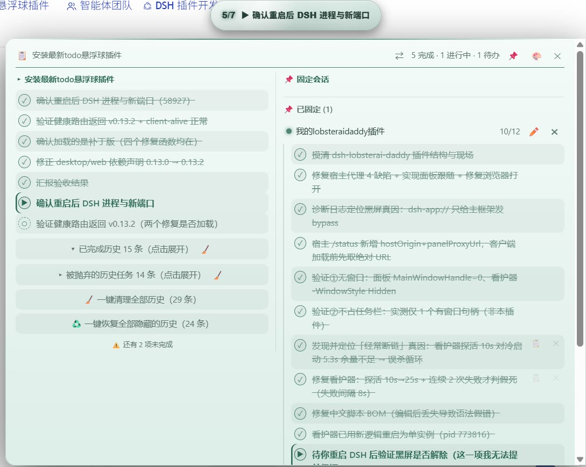
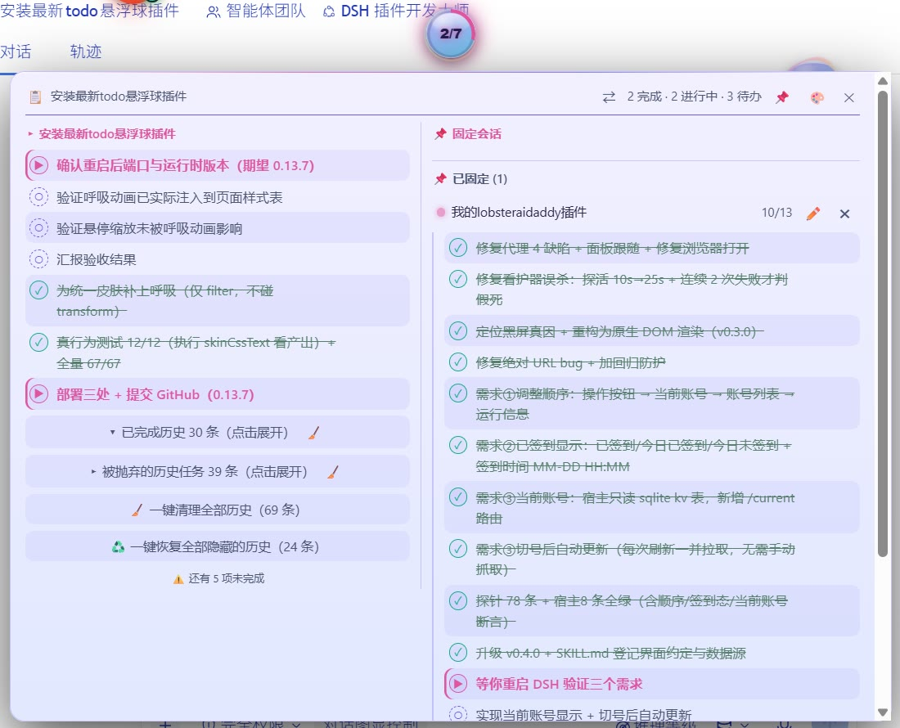
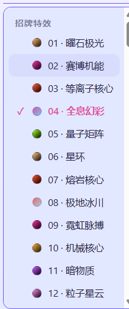

# dsh-todo-float-ball

**Your AI agent runs long tasks — but its plan keeps scrolling out of sight. Turn it into a progress ball that never leaves the screen.**
**让 AI 的任务清单常驻屏幕 —— DeepSeek Harness（DSH）进度悬浮球插件。**

[](https://www.npmjs.com/package/dsh-todo-float-ball)
[](LICENSE)
[](https://github.com/loyalchiiina/dsh-todo-float-ball)

English | [简体中文](README.zh.md)

---

## What it does · 一句话说明

When you give an AI agent a multi-step job in DSH, it records the plan with the built-in `todo_write` tool. The official UI renders that plan as a thin strip above the input box — **but the strip is easy to miss, scrolls away with the conversation, and folds itself while the agent is still working.** You end up hunting through the transcript to answer "how far along is it?"

**dsh-todo-float-ball** moves that checklist onto a persistent floating ball:

| The problem | What this plugin does |
|---|---|
| The plan strip scrolls away; progress is invisible | A ball **pinned to a window corner** (bottom-right by default; draggable, position remembered across restarts) |
| You must expand a panel to see "how many are done" | The ball face shows **`done/total`** directly, with a progress ring |
| You can't tell which item the agent is on right now | **The active task's name** appears on the ball; capsule mode shows only that line |
| Several sessions running — you keep switching to check each | **Pin multiple sessions and the panel shows their progress side by side**, so parallel work is visible at a glance |
| Hard to tell finished from unfinished | **Status colour at a glance**: pulsing orange = working, green = all done, blue = pending only, gray = no list |
| Want to look back at previously planned tasks | **History archive**: when a new plan replaces the old one, the old tasks fold into a "history" section instead of vanishing |
| The ball blocks your view | Hide it, collapse it to a capsule, or drag it — with per-session memory |

**It is a pure, read-only companion**: the plugin never modifies the official panel, the conversation, or any other plugin.

## Why it matters · 为什么值得装

- **Built for long unattended runs** — DSH agents continue across many turns; you may not look at the screen for ten minutes. The orange glow and `3/8` tell you at a glance that work is still moving, and how far.
- **Parallel sessions stop being guesswork** — pinning side-by-side columns puts two conversations' progress in one panel; no more clicking back and forth.
- **Visually consistent with its siblings** — shares one **128-skin** catalogue with the `dsh-skill-browser` and `dsh-font-enhancer` balls (plus the 6 classic skins kept as a separate "legacy" group), so all three switch together and match.
- **One codebase, two targets** — identical behaviour on Desktop (Electron) and the web UI.
- **Zero intrusion, zero config** — install and it works; no config files, no changes to the official UI. `Shadow DOM + all:initial` keeps styles isolated, so it cannot clash with your theme or skin plugins.
- **Reliable data** — three-tier sync: the runtime's `sessions` service (authoritative projection) drives the ball; a debounced `MutationObserver` on the official todo panel and a passive transport tap are fallbacks that only speak when the service has produced nothing for that session. **Even when the official strip is collapsed — or unrendered — the ball still has the full list.**

## Screenshots

### Pinned sessions — side-by-side task progress

Pin two conversations and the panel shows both progress columns at once, so you can watch parallel work without switching sessions.





### Capsule mode

Right-click the ball to collapse it into a slim capsule that shows the running task and the `done/total` count — ideal when screen space is tight.


### Skins

128 built-in skins (plus a separate "legacy" group holding the 6 pre-catalog skins), shared with the sibling skill-browser / font-enhancer balls so all three stay visually consistent. Groups: 招牌特效 28 / 浓郁深底 38 / 尘埃灰调 20 / 柔光深底 15 / 中性点缀 10 / 浅色纸面 17.



## Basic usage · 基本用法

- **The ball** sits in a window corner at all times (default: bottom-right).
- **Its face** shows live progress: `done/total`, with the active task's name underneath. A ring around it mirrors the same percentage.
- **Click** the ball to expand the full task panel; **click again** (or press `Esc`) to fold it back.
- **Right-click** to switch to capsule mode, which shows only the running task and the count.
- **Drag** it anywhere; the position is remembered per profile. Drag it off-screen and it snaps back.
- **Colour** tells you the state at a glance: pulsing orange = work in progress, green = all done, blue = pending only, gray = no list yet.

It is a pure, read-only companion: the plugin never modifies the official panel, the conversation, or any other plugin.

## 功能总览 · At a glance（中英对照 / Bilingual）

### Floating ball · 悬浮球

| 中文 | English |
|---|---|
| 常驻可拖拽悬浮球（默认右下角），位置存 `localStorage` 并跨重启恢复，越界旧位置自动拉回 | Persistent draggable ball (default bottom-right); position saved to `localStorage` and restored across restarts, off-screen positions clamped back |
| 球面实时显示 `done/total` + 当前进行中任务名（截断），随 todo_write 实时刷新 | Live `done/total` plus the active task's name on the ball face, updated in real time |
| 状态颜色一眼可读：橙脉动=进行中 / 绿=全部完成 / 蓝=只有待办 / 灰=暂无清单 | Status colours at a glance: orange pulse = working, green = all done, blue = pending only, gray = no list |
| 每项任务带图标与配色：✓ 完成（绿+删除线）、▶ 进行中（橙）、○ 待办（灰虚线） | Per-item icons & colours: ✓ done (green, strikethrough), ▶ in progress (orange), ○ pending (dashed gray) |

### Panel & data · 面板与数据

| 中文 | English |
|---|---|
| 点球折叠/展开面板，靠屏幕边缘自动翻侧 | Click to fold/expand; the panel flips sides near the screen edge |
| 三路数据同步：**主** = 运行时 `sessions` 服务的权威投影帧；**兜底 1** = MutationObserver 抓官方 todo 面板；**兜底 2** = 被动拦截传输帧。兜底仅在权威通道对该会话尚无数据时才发言，官方面板折叠时也有完整清单 | Three-tier sync: **primary** = the runtime `sessions` service (authoritative projection); **fallback 1** = DOM observer on the official panel; **fallback 2** = passive transport tap. Fallbacks only speak while the authoritative channel has produced nothing for that session — full list even when the strip is collapsed |
| Shadow DOM + `all:initial` 样式隔离，不进不出，主题/皮肤插件互不干扰 | Shadow DOM with `all:initial` — no style leaks in or out, immune to theme/skin plugins |
| 桌面端（Electron）与网页端同一份代码双端可用 | One codebase for Desktop (Electron) and the web UI |

### History & pinned sessions · 历史与固定会话

| 中文 | English |
|---|---|
| 快照合并不再冲掉旧任务——旧任务进入历史归档区 | Snapshots merge instead of replacing — older todos become a history archive |
| **球上的数字只反映当前这一轮**（与官方进度条同口径），历史不会把分母撑大 | **The number on the ball covers the current round only** (same basis as the official strip); history never inflates the denominator |
| **展开清单分两段**：上面是可折叠的历史（已完成历史 / 被抛弃的历史任务），中间一道分界线 `── 当前进度 · 5/10 完成 ──`，下面才是当前轮的任务 | **The expanded list has two sections**: collapsible history on top, a divider `── Current · 5/10 done ──` in the middle, the current round's todos below |
| 行级 ✕ 隐藏、两个独立折叠行、🧹 批量清理、♻️ 一键恢复、📋 整行复制 | Per-row ✕ hide, two independent fold rows, 🧹 batch cleanup, ♻️ one-click restore, 📋 full-text copy |
| 📌 固定会话与当前对话共用同一历史渲染器，状态按会话独立 | 📌 Pinned sessions render through the same history renderer, with per-session state |
| ⇄ 布局切换：上下堆叠 ⇄ 左右并排（左当前列表、右固定会话，带列标题） | ⇄ layout switch: stacked ⇄ side-by-side (current + pinned columns with captions) |

### Discipline injection · 纪律注入

| 中文 | English |
|---|---|
| 宿主端向每次会话系统提示注入 todo 纪律段（order=190，6 条规则，实测 498 字符）——装上插件即生效，无需加载技能 | Host injects a stable todo-discipline section (order=190, 6 rules, 498 chars measured) into every session — works the moment the plugin is installed |
| 硬门：每轮首个工具调用若不是 todo_write 会被拒绝并提示补写（可用 `enforceFirstTodoWrite: false` 关闭） | Hard gate: the first tool call of each turn must be `todo_write` or it is denied (disable with `enforceFirstTodoWrite: false`) |
| 只有显式布尔 `false` 才关闭；`"false"`/`0`/缺 config 均保持开启 | Only an explicit boolean `false` disables it; `"false"`/`0`/missing config keep it ON |

### Skins & privacy · 皮肤与隐私

| 中文 | English |
|---|---|
| 三球共享 128 款皮肤目录（含 6 款经典旧皮肤），任一处切换全同步 | Shares the 128-skin catalogue across the three balls (6 classic skins kept), synced everywhere |
| 零遥测、零数据上传，仅一条本机回环健康路由 | Zero telemetry, zero data upload — just a loopback-only health route |

## Features

| Feature | Detail |
|---|---|
| Persistent floating ball | Always visible in the viewport, draggable anywhere, position saved to `localStorage` and restored across restarts (off-screen stale positions are clamped back) |
| Live progress | `done/total` on the ball face plus the first active task's content (truncated), updated in real time |
| Fold / expand | Click the ball to toggle the task panel; the panel opens next to the ball and flips sides when near the screen edge |
| Status colors | Per-item icons and colors: ✓ completed (green, strikethrough), ▶ in progress (orange), ○ pending (dashed gray); ball itself: orange pulse / green / blue / idle gray |
| Data sync (3 tiers) | **Primary**: `ctx.sessions.list.subscribe` — the runtime's authoritative `todos` projection, plus a 2 s pull as a safety net. **Fallback 1**: a debounced `MutationObserver` over `[data-testid="todo-panel"]`. **Fallback 2**: a passive tap on `window.fetch` and `WebSocket.onmessage` that only reacts to projection-shaped frames. Fallbacks are gated by `hasPrimaryData()` and stay silent once the service has spoken for a session |
| Shadow DOM isolation | All UI lives inside an open Shadow DOM with `all:initial` — no style leaks in or out, immune to theme/skin plugins |
| Dual-end support | Works in DSH Desktop (Electron window) and the web UI (browser) with the same code, because both render the same page; the UI mounts on `<html>` to dodge `transform`-related `position:fixed` breakage |
| Privacy-friendly | Zero telemetry, zero data upload. The only host-side surface is a loopback-only health route (`/dsh-todo-float-ball/health`) |
| **Discipline injection (v0.9.0)** | The host injects a 6-rule todo discipline (498 chars measured, `order=190`) into the system prompt of **every session** — **works as soon as the plugin is installed, no skill needs to be loaded**; turn it off with `injectDiscipline: false` |
| **History archive & panel tools (v0.10.0)** | Merged snapshots no longer wipe older todos — they become a foldable history archive; per-row ✕ hide, two independent fold rows, 🧹 batch cleanup, ♻️ one-click restore, 📋 full-text copy; all counters reflect only the latest snapshot |
| **Pinned-panel parity & layout switch (v0.11.0)** | 📌 pinned sessions render through the *same* history renderer as the current view (folds, 🧹, ♻️, per-session state and per-session action scoping); the panel header gained a ⇄ button to flip between a stacked layout and a side-by-side layout (left = current list, right = pinned sessions) with per-column captions |

## Pinned sessions & panel layout (v0.11.0)

- **One renderer, two lists** — the current conversation and every pinned (📌)
  conversation are rendered by the same `historySectionHtml()` function: latest
  snapshot flat, then `▾ Completed history (N)` and
  `▸ Abandoned history tasks (M)`, each fold with its own 🧹, plus
  `🧹 Clear all history` and `♻️ Restore all hidden history`. Pinned panels got
  the last two rows for the first time in this release.
- **Per-session state** — fold open/closed and hidden rows are keyed by session
  id, so expanding or cleaning one conversation never moves another one; every
  control carries the id of the list it was rendered for (`data-ownsid`).
- **Stable snapshot boundary** — the snapshot/history split is taken on the raw
  list and the hidden-row filter is applied afterwards, so hiding a snapshot row
  can no longer drag an archived row into the live area or shift a fold count.
- **⇄ layout switch** — stacked (current list above, pinned below) or
  side-by-side (left current, right pinned). The preference is stored in
  `localStorage["dsh-todo-float-ball-layout"]` and restored on load.
- **Column captions** — in side-by-side mode the left column is captioned with
  the current conversation title and the right one with `📌 固定会话`; in stacked
  mode the captions stay hidden and nothing about the old layout changes.


## History & panel management (v0.10.0)

A plan is rewritten many times during a long task. From v0.10.0 the panel keeps
the **latest snapshot** as the live list and archives everything older instead
of discarding it:

- **Merge, not replace** — a fresh snapshot updates the leading `snapLen` rows
  of the session bucket; previous items that are not part of the new snapshot
  are appended after it, so old tasks never disappear.
- **Statistics mean "the current plan"** — the ball face (`done/total`), the
  progress ring, the header summary and the "N items left" notice count only
  the latest snapshot (`snapshotList()`); history is a pure archive.
- **Per-row hide (✕)** — hover a history row and click ✕ to hide it. Hidden
  rows live in `localStorage` (`dsh-todo-float-ball-hidden-v1`, per session);
  the data layer is untouched. Pinned (📌) sessions hide rows independently —
  a hidden row in session A can never hide a row in session B (`data-ownsid`).
- **Two fold rows** — `▾ Completed history (N)` and `▸ Abandoned history
  tasks (M)` are independent collapsible rows (collapsed by default); the
  latest snapshot always renders fully expanded.
- **Batch cleanup (🧹)** — each fold row has a 🧹 button to clear that fold,
  plus a `🧹 Clear all history (X)` row that hides both folds at once.
- **One-click restore (♻️)** — `♻️ Restore all hidden history (X)` appears
  only while something is hidden and unhides everything in the session.
- **Row copy (📋)** — copies the *full* task text (not the 80-char display
  truncation), with a real ✓/⚠ feedback.

## Discipline injection (v0.9.0)

DSH skills are **loaded on demand**: a session that never loads the `todo-show-discipline` skill carries no todo rules at all. Since v0.9.0 the host half injects a stable "todo discipline" section into every session's system prompt, so **installing the plugin is enough** — independent of which skill got loaded, which preset is active, and whether you run Desktop or the web UI.

- **ON by default** (no `config` row means ON).
- To turn it off: add `config: { injectDiscipline: false }` to this plugin's row in `cordis.patch.yml` (or your profile's patch layer), then **restart DSH**.
- Only an explicit boolean `false` disables it; `"false"` / `0` / typos / a missing `config` all keep it ON (guards against accidental shutdown).
- The injected text is deliberately short (a system-prompt section costs tokens in every session); the full rules stay in the `todo-show-discipline` skill, which is disabled for model invocation by default once this plugin is installed, and can be re-enabled if you uninstall the plugin.

## Install

The plugin is a standard DSH npm package (`dsh.bundle` self-declared). Two ways:

### From npm (when published)

```bash
npm install dsh-todo-float-ball
```

Then add `"dsh-todo-float-ball"` to both `dependencies` and `dsh.profile.bundles` in your profile's `package.json` (e.g. `%USERPROFILE%\.dsh\profiles\desktop\package.json`), and restart DSH.

### Manual

Copy this package folder into your profile's `node_modules` (a real copy — do **not** use `link:` / `file:` dependencies, they can trigger DSH's install-recovery loop), then register it the same way and restart.

After the restart you should see the ball in the bottom-right corner. Verify the host half with:

```
http://127.0.0.1:<your DSH port>/dsh-todo-float-ball/health
→ {"ok":true,"plugin":"dsh-todo-float-ball","version":"<the installed package.json version>"}
```

**Use your actual port.** DSH Desktop defaults to `port: 0` (a fresh random port on every restart), so there is no fixed number to hardcode. Read it from the address bar of the DSH window, or pin it by setting `port` in `%USERPROFILE%\.dsh\desktop-preferences.json`. A fixed `43120` only applies if you set it yourself. The route is also loopback-only and refuses any non-renderer request with `403 Browser access is disabled`, so `curl` will not work unless you enable `browserAccess`.

## How it works

The official todo data is a **session projection**:

1. `@deepseek-ai/dsh-tool-todo` registers the `todo_write` tool and a `todos` projection unit on `sessionProjections`; every call appends a `todo/write` snapshot to the session log.
2. `@deepseek-ai/dsh-client-connection` broadcasts the current value as a control frame: `{type:"projection", sessionId, key:"todos", value:[{content,status}...]}`.
3. `@deepseek-ai/dsh-client-ui-conversation` renders it as the plan strip above the input box (`[data-testid="todo-panel"]`).

This plugin reads from all three surfaces without touching any of them, in strict priority order:

- **Primary — `sessions` service**: the client half declares `inject: ["sessions"]` and subscribes to the runtime's global session registry (`ctx.sessions.list.subscribe`, with a 2 s pull as a safety net in case a callback stops firing after a shell rebuild). This channel is authoritative: it is the whole list, it carries history, and it wins every disagreement.
- **Fallback 1 — DOM panel**: a debounced (200 ms) `MutationObserver` watches `[data-testid="todo-panel"]`, reads `li[data-status]` items when the strip is expanded, and parses the localized count label (e.g. "1 完成 · 2 进行中") when it is collapsed. It returns immediately whenever `hasPrimaryData()` says the service has already spoken for that session — otherwise the two channels would alternate on every observer tick and the ball would flicker.
- **Fallback 2 — transport tap**: a one-time, defensive wrapper around `window.fetch` (cloning responses, text/json only) and `WebSocket.prototype.onmessage` (text frames) feeds every payload through a strict extractor that only reacts to objects shaped like projection frames, `todo/write` events, or `{todos:[...]}` snapshots. Malformed payloads are ignored; nothing is ever written back.

All channels funnel into one normalizer: items are filtered to the three known statuses, blank contents are dropped, and unchanged lists are no-ops (cheap signature comparison). The **snapshot boundary** is taken from the authoritative frame length — `todo_write` replaces the whole list, so that frame *is* the live plan and everything merged in behind it is archive. That single rule is what keeps `done/total` matching the official panel; the pre-0.14.6 code used a monotonic high-water mark that could never shrink and drifted further off with every round.

## FAQ

**The ball doesn't show up.**
Check the health URL above; if it responds, the host half is fine — the client bundle may have been blocked (look for `loaded without registering` in DSH logs; the bundle id must equal the package name). If it doesn't respond, the plugin isn't in your profile's bundles list.

**Can I move the ball?**
Yes — drag it anywhere. The position persists per browser/renderer profile. If a saved position somehow lands off-screen, the plugin clamps it back into the viewport on startup.

**Does it work while the official strip is collapsed?**
Yes. That is exactly why channel B exists: the official strip renders only a counts label when collapsed, while projection frames always carry the full list.

**Does it slow the UI down?**
No. The observer is debounced (200 ms), the transport tap only string-scans for `"todos"` before parsing, and the ball-respawn watchdog gives up after 300 × 2 s = 10 minutes (the visibility/sync poll is deliberately kept alive, because it is also how a skin switched from a sibling plugin reaches this ball).

## Compatibility

- DSH Desktop 2.x (desktop profile) and DSH web (web profile)
- No `peerDependencies` — the plugin is self-contained and talks to DSH only through public DOM/HTTP surfaces

## License

MIT
