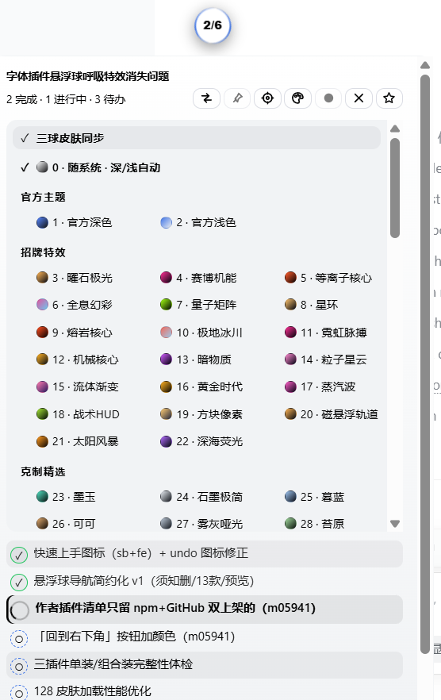
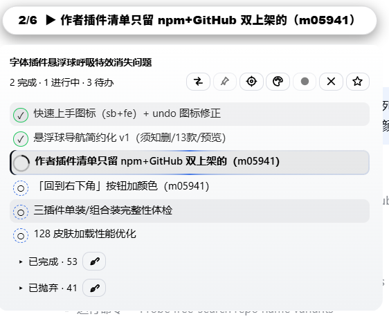
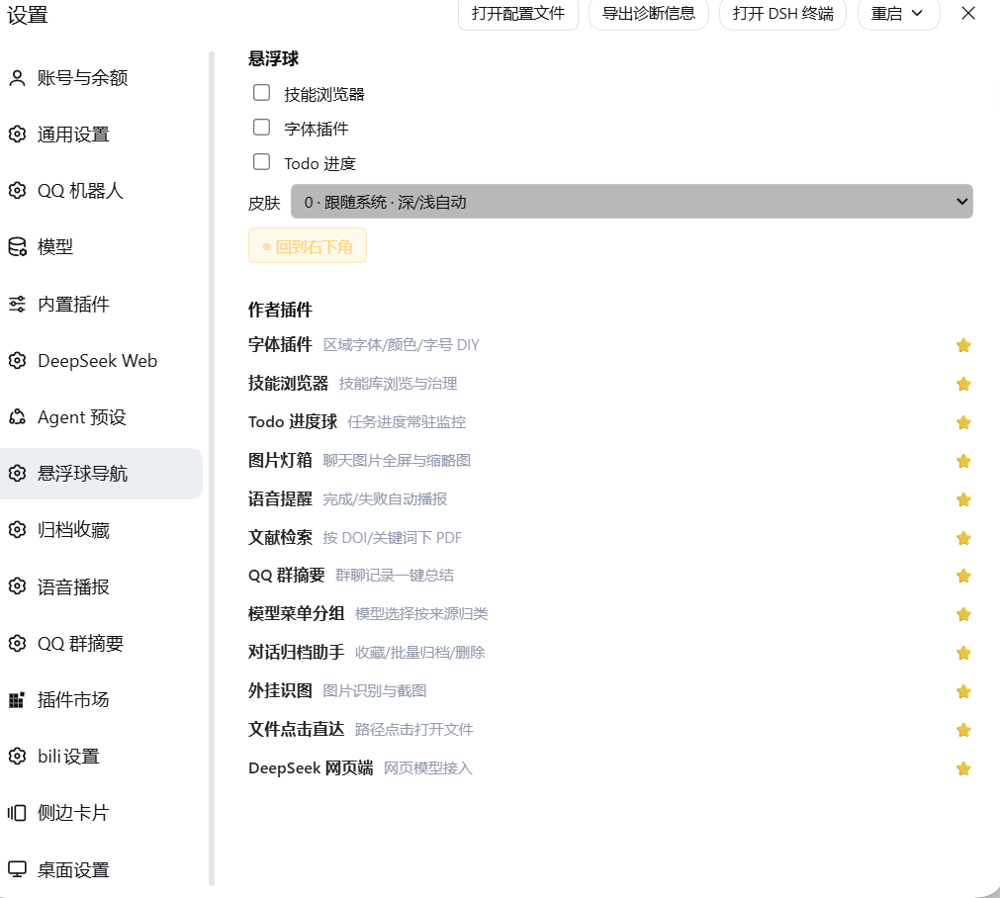

# dsh-todo-float-ball

**AI 在跑长任务，计划清单却总在眼前消失？把它变成一颗常驻桌面的进度球。**

把 DeepSeek Harness（DSH）的任务清单搬到桌面右下角的一颗悬浮球上：`已完成/总数` 常驻可见、当前进行中的任务名直接写在球面上，还能拖、能缩成胶囊、能换 130 款皮肤。

[](https://www.npmjs.com/package/dsh-todo-float-ball)
[](LICENSE)
[](https://github.com/loyalchiiina/dsh-todo-float-ball)

[English](README-en.md) | 简体中文

---

## 效果图

### 皮肤菜单 + 悬浮球

130 款皮肤分 8 组，菜单首行是「三球皮肤同步」开关，第二行是「0 · 随系统 · 深/浅自动」。



### 胶囊态 + 面板展开

右键球体收起为横向胶囊（进度条 + 当前任务名）；单击展开完整任务面板，进行中的那一项带旋转描边环。



### 设置页「悬浮球导航」

设置页里的共用分区：三球显隐、皮肤下拉、◎ 回到右下角、作者插件清单。



---

## 一句话说明

DSH 里让 AI 干活时，它会用内置的 `todo_write` 记一份任务清单。官方界面把这份清单渲染成输入框上方的一小条——**但那一小条很容易被忽略、会随对话滚走、助手还在干活时它就已经折叠了**。你被迫反复翻对话找"现在到底做到哪一步了"。

**dsh-todo-float-ball 把这份清单搬到一颗常驻悬浮球上：**

| 你遇到的 | 这个插件怎么解决 |
|---|---|
| 计划条随对话滚走，找不到进度 | 球**常驻桌面右下角**（可拖拽，位置跨重启记忆，拖出屏幕自动拉回） |
| 想知道"几项做完了"，得展开细看 | 球面**直接显示 `已完成/总数`**，外圈进度环同步可视化 |
| 不知道助手当前在忙哪一项 | 球面显示**当前进行中任务的名称**；胶囊态只显示这一行 |
| 屏幕空间紧张，球占地方 | 右键切成**横向胶囊**：一条进度条 + 任务名 |
| 同时跑多个会话，来回切换看进度 | **固定多个会话，面板并排显示多栏进度**，一屏看住所有并行任务 |
| 任务做完没做完，颜色分不清 | **状态色一眼可读**：橙脉动=进行中 / 绿=全部完成 / 蓝=只有待办 / 灰=暂无清单 |
| 想回看之前排过的任务 | **历史归档**：新计划覆盖旧计划时，旧任务自动折叠进"已完成历史 / 被抛弃历史"，不会凭空消失 |
| 皮肤看腻了 / 和别的插件风格不搭 | **130 款皮肤**（官方主题 / 招牌特效 / 克制精选 + 5 组配色），三球可同步可独立 |
| 浅色皮肤上白字看不清 | **强制字色**：自动 / 黑 / 白一键切，官方皮肤下自动锁定 |

**它只是一个只读的观察者**：插件从不修改官方面板、不改对话内容、不干扰其他插件。

## 为什么值得装

- **专治"长任务失联"** —— DSH 的 AI 会自动续跑很多轮，你可能十几分钟不看屏幕。球上的橙灯和 `3/8` 让你一眼就知道**还在跑、跑到哪了**。
- **多会话并行不再瞎猜** —— 固定标签把两栏进度并排摆在同一个面板里，不用左点右点来回切。
- **三球视觉统一** —— 与姊妹插件 `dsh-skill-browser`、`dsh-font-enhancer` 共用同一套 **130 款皮肤**目录，三个球可以一起换肤、风格一致，也可以让某个球独立。
- **双端同一份代码** —— 桌面端（Electron）和网页端行为一致。
- **零侵入零配置** —— 装上即用，不写配置文件也不改官方 UI；`Shadow DOM + all:initial` 做样式隔离，与你其他主题/皮肤插件互不干扰。
- **数据来源可靠** —— 三路同步：**主** = 运行时 `sessions` 服务的权威投影帧；**兜底 1** = 官方 todo 面板的 DOM 观察；**兜底 2** = 传输帧被动拦截。兜底只在权威通道对该会话尚无数据时才发言。**官方那一条折叠了、甚至没渲染，球上依然是完整清单**。

---

## 功能详解

### 悬浮球与胶囊态

- **圆形悬浮球**常驻窗口右下角（默认 `right:18px; bottom:18px`），随时可见。
- 球面实时显示 **`已完成/总数`**，下方一行是**当前进行中任务的名称**（超长自动截断）。
- **外圈进度环**用同一比例可视化进度（`conic-gradient` + 百分比遮罩），与球面数字同源。
- **状态色**：橙色脉动 = 正在干活 / 绿色 = 全部完成 / 蓝色 = 只有待办 / 灰色 = 暂无清单。
- **可拖动**：按住拖到任意位置，坐标按 profile 存 `localStorage`，重启后恢复；**保存的坐标跑到屏幕外时会自动拉回视口内**（防"球丢了"）。
- **胶囊态**：右键球体在【圆形球】与【横向胶囊】之间切换。胶囊是一条横向进度条 + 任务名 + `已完成/总数`，屏幕空间紧张时用。
- **点击**展开完整任务面板；**再点一下**（或按 `Esc`）收起。

### 任务面板

- **任务清单**：每项带状态图标与配色——✓ 已完成（绿色 + 删除线）、▶ 进行中（橙色）、○ 待办（灰色虚线圈）。
- **进行中旋转描边环**：正在执行的那一项外圈有一道绕行描边（`@property --tfb-spin` + `tfbBorderSpin`），一眼看出"就是这条在跑"。
- **已完成历史折叠**：`▾ 已完成 · N`，默认收起，点标题展开。
- **被抛弃历史折叠**：`▸ 已抛弃 · N`，被新计划替换掉的未完成任务收在这里。
- **分界线**：历史区与当前轮清单之间有一道 `── 当前进度 · 5/10 完成 ──` 分界线（两侧渐隐细线 + 圆角胶囊标签，两套皮肤各自配色，`pointer-events:none` 不挡点击），把"历史贡献"和"官方最新清单"在视觉上一刀切开。
- **行级 ✕ 隐藏**、**🧹 一键隐藏本区**、**↩︎ 恢复已隐藏的 N 条**、**📋 整行复制**（复制完整文本，非显示截断）。
- **📌 固定会话**：把别的会话也钉到面板里，与当前对话走**同一个渲染器**，折叠开合与隐藏记录**按会话隔离**。
- **⇄ 布局切换**：上下堆叠 ⇄ 左右并排，偏好写 `localStorage`，下次打开自动恢复；左右并排时带列标题。

### 皮肤：130 款，8 组

皮肤菜单（标题栏 🎨 按钮）分组与数量（实测目录，显示序号 1..130 连续）：

| 分组 | 数量 | 说明 |
|---|---|---|
| 官方主题 | 2 | **1 · 官方深色** / **2 · 官方浅色**，与 DSH 界面同色系 |
| 招牌特效 | 20 | 曜石极光、赛博机能、全息幻彩……自带外圈光带与旋转描边、呼吸动画 |
| 克制精选 | 8 | 墨玉、石墨极简、暮蓝……静态、安静、不抢眼 |
| 浓郁深底 | 38 | 高饱和深色底 |
| 尘埃灰调 | 20 | 低饱和灰调 |
| 柔光深底 | 15 | 柔和暗色 |
| 中性点缀 | 10 | 中性色 + 一点强调色 |
| 浅色纸面 | 17 | 浅色底，适合白天 |

- **0 · 随系统 · 深/浅自动**：菜单第二行。跟随 `prefers-color-scheme`，系统切深浅色时球和面板实时跟着切（解析到「官方深色」或「官方浅色」）。
- **三球皮肤同步**：菜单第一行的勾选行。**勾选 = 跟随全局皮肤**（三球同款，改一个三个一起变）；**不勾 = 本球独立皮肤**，只影响 Todo 球，全局换肤不动它。
- **招牌特效类皮肤自带外圈光带**（底部 `radial-gradient` 光带 + 旋转描边），随皮肤自动出现或消失，**没有单独的开关**——换皮肤就是开关。

### 强制字色

标题栏的 ◐ 按钮循环切换 **自动 → 黑 → 白**，作用于**面板内外所有文字**（球面标签、任务行、折叠行、提示语），解决浅色皮肤白字看不清 / 深色皮肤黑字看不清。

- **自动**：跟随皮肤自带的文字色。
- **官方皮肤下自动锁定**：选到 **1 · 官方深色**、**2 · 官方浅色**，或选「0 · 随系统」解析到官方皮肤时，字色由皮肤强制决定（深色皮肤 → 白字、浅色皮肤 → 黑字），按钮呈锁定态、点击不再切换——官方皮肤本身就带正确的对比度，不需要也不允许手动覆盖。

### 拖到屏幕顶部也不丢

DSH 桌面端窗口顶部约 40px 是窗口拖拽带（Electron 的 `app-region: drag`）。球和面板都写了：

```css
.tfb-ball, .tfb-panel, .tfb-theme-menu {
  -webkit-app-region: no-drag;
  app-region: no-drag;
}
```

所以**把球拖到屏幕最顶端也不会点不动、拖不动**——否则落在拖拽带上的球会被窗口拖拽逻辑吃掉所有鼠标事件，看着在、实际已经"死"了。

### 设置页「悬浮球导航」

DSH 设置页里有一个 **「悬浮球导航」** 分区（`settings.section`，`order: 22`）。**这个分区由姊妹插件 `dsh-skill-browser` 注册**，本插件只读它写入的共享键，属于三球共用的一块面板：

- **三球显隐**：技能浏览器 / 字体插件 / **Todo 进度** 三个勾选框（没装的插件显示「（未安装）」且置灰）。
- **皮肤下拉**：`0 · 跟随系统 · 深/浅自动` + 8 个分组的全部皮肤，等价于三球同步时的全局皮肤。
- **◎ 回到右下角**：一键把球归位。
- **作者插件**：12 个插件清单（名字 + 一句话描述 + ⭐ 链接）。

> 装了这一组插件里任意一个，这个分区就会出现；只装 Todo 球而没有 `dsh-skill-browser` 时，用球自己的标题栏按钮（◎ 归位、🎨 皮肤）做同样的事。

### 标题栏按钮（全部黑白线性图标）

面板标题栏那排按钮都是 `stroke: currentColor` 的线性 SVG，跟着字色走，不用 emoji：

| 图标 | 动作 |
|---|---|
| ⇄ | 切换面板布局：上下堆叠 / 左右并排 |
| 📌（线性） | 固定 / 取消固定当前会话 |
| ◎ | 归位到右下角 |
| 🎨（线性调色板） | 打开皮肤菜单 |
| ◐ / ● / ○ | 强制字色：自动 / 黑 / 白（官方皮肤下锁定） |
| ✕ | 折叠面板 |
| ☆ | 去 GitHub 点 Star |

## 快速上手

1. **装上就有效果**：装好后右下角出现一颗球。没有任务时它是灰色的，显示 `✓`。
2. **让 AI 干活**：随便让它做个多步骤任务，它会调用 `todo_write`，球面立刻变成 `0/3`、`1/3`……并显示当前那一项的名字。
3. **点球看全清单**：单击球体展开面板，进行中的那项带旋转描边环；再点收起。
4. **右键变胶囊**：觉得球挡视线就右键切成横向胶囊，只留一条进度条 + 任务名。
5. **换个皮肤**：点 🎨 打开皮肤菜单。想跟另外两个球一致就勾上「三球皮肤同步」；想单独一个球漂亮就取消勾选再选。懒得选就点 `0 · 随系统 · 深/浅自动`。
6. **字看不清就调**：点 ◐ 在 自动 → 黑 → 白 之间切。（官方皮肤下这个按钮会锁定，是正常行为。）
7. **拖到哪都行**：按住球拖到顺手的位置，位置会记住；拖到屏幕顶端也不会失效。想归位就点 ◎。

## 基本用法

- **悬浮球**始终固定在窗口角落（默认右下角）。
- **球面**实时显示 `已完成/总数`，下方显示当前进行中的任务名；外圈进度环同步可视化同一比例。
- **单击**展开完整任务面板；**再点一下**（或按 `Esc`）收起。
- **右键**切换到胶囊模式。
- **拖拽**到任意位置，按 profile 记忆坐标；拖出屏幕会自动拉回。
- **颜色**一眼看状态：橙色脉动 = 正在干活，绿色 = 全部完成，蓝色 = 只有待办，灰色 = 暂无清单。

## 安装

### 从 DSH 插件市场安装（推荐）

在 DSH 的插件市场里搜索 **`dsh-todo-float-ball`** 或 **`Todo 进度球`**，点安装后重启 DSH。

### 从 npm 安装

```bash
npm install dsh-todo-float-ball
```

然后在你所用 profile 的 `package.json`（如 `%USERPROFILE%\.dsh\profiles\desktop\package.json`）里，把 `"dsh-todo-float-ball"` 同时加进 `dependencies` 和 `dsh.profile.bundles`，重启 DSH 生效。

### 手动安装

把本包目录整体复制进 profile 的 `node_modules`（必须是真实目录复制——**不要**用 `link:` / `file:` 依赖，会触发 DSH 安装恢复死循环），按上面同样方式注册后重启。

重启后右下角应出现悬浮球。可用下面的地址验证宿主端已挂载：

```
http://127.0.0.1:<你当前的 DSH 端口>/dsh-todo-float-ball/health
→ {"ok":true,"plugin":"dsh-todo-float-ball","version":"<已安装 package.json 里的版本号>"}
```

**端口要填你自己的。** DSH 桌面端默认 `port: 0`（每次重启换一个随机端口），没有固定值可抄。可从 DSH 窗口地址栏读取，或在 `%USERPROFILE%\.dsh\desktop-preferences.json` 里把 `port` 固定下来。该路由还只接受本机渲染进程的请求，其他请求一律回 `403 Browser access is disabled`，所以除非你打开 `browserAccess`，`curl` 是拿不到的。

## 适配版本

- DSH 内核（`@deepseek-ai/dsh`）：**0.2.1-rc.3**（`package.json` 的 `engines.dsh` 已声明 `>=0.1.7-rc.1`）
- DSH 桌面端：**2.0.20-next**（DSH NEXT）
- Node.js：`^22.19.0 || >=24.0.0`
- 已在上述版本实测通过；低版本 `0.1.7-rc.1` 及以上兼容。

## 实现原理

官方的 todo 数据是一条**会话投影（session projection）**：

1. `@deepseek-ai/dsh-tool-todo` 注册 `todo_write` 工具，并在 `sessionProjections` 上登记 `todos` 投影单元；每次调用向会话日志追加一条 `todo/write` 快照；
2. `@deepseek-ai/dsh-client-connection` 把当前值以控制帧广播：`{type:"projection", sessionId, key:"todos", value:[{content,status}...]}`；
3. `@deepseek-ai/dsh-client-ui-conversation` 把它渲染成输入框上方的任务条（`[data-testid="todo-panel"]`）。

本插件在两端各挂一个只读探针，不碰任何一端：

- **主路**：订阅运行时 `sessions` 服务的权威投影帧（另有 2 秒轮询兜底，防 shell 重建后回调失联）。
- **兜底一（DOM）**：一个带 200ms 防抖的 `MutationObserver` 盯着 `[data-testid="todo-panel"]`——面板展开时读 `li[data-status]` 全量清单；折叠时解析本地化的计数文案（如"1 完成 · 2 进行中"，含中文数字解析）。
- **兜底二（传输层）**：一次性、防御式的 `window.fetch` 包装（clone 响应、只处理文本/JSON）与 `WebSocket.prototype.onmessage` 包装（文本帧），把每个载荷送进严格的提取器——只对形如投影帧、`todo/write` 事件、`{todos:[...]}` 快照的对象起反应，其余一律忽略，绝不回写。

所有通道汇入同一个归一化器：过滤出三种合法状态、丢弃空内容、列表无变化时零开销跳过（签名比对）。兜底由 `hasPrimaryData()` 把关，权威通道有数据即静默。

**历史归档的口径**：权威通道的一帧就是当前计划的全部（`todo_write` 是整表替换），所以 `snapLen = norm.length`，其后的合并项即历史。球面计数、进度环、头部汇总只统计**最新快照**，历史是纯档案、不进任何计数。

## 常见问题

**悬浮球不出现？**
先开上面的 health 地址：能返回说明宿主端正常，是客户端 bundle 没加载（查 DSH 日志有无 `loaded without registering`，bundle id 必须与包名一致）；不能返回说明插件没进 profile 的 bundles 列表。

**球拖到屏幕顶端就点不动了？**
不会。球和面板都写了 `app-region: no-drag`，落在窗口拖拽带上依然可点可拖。若真遇到，请报 issue 并附 DSH 版本。

**选了官方皮肤，字色按钮点不动？**
正常。官方皮肤（官方深色 / 官方浅色 / 随系统解析到官方皮肤）下字色由皮肤强制决定并锁定按钮，保证对比度。

**「三球皮肤同步」勾和不勾有什么区别？**
勾选 = 跟随全局皮肤（改一个三个球一起变）；不勾 = 这个球用自己的皮肤，全局换肤不影响它。

**官方面板折叠时也能同步吗？**
能。这正是兜底存在的意义：官方面板折叠时只渲染计数文案，而投影帧始终携带完整清单。

**会拖慢界面吗？**
不会。观察器 200ms 防抖；传输层窃听先做 `"todos"` 字符串预筛再解析；兜底看门狗跑约 10 分钟后自动停止。

## 兼容性

- DSH 桌面端 2.x（desktop profile）与 DSH web（web profile）
- Node.js `^22.19.0 || >=24.0.0`
- 插件自包含，只通过公开 DOM/HTTP 面与 DSH 交互；皮肤目录与 `dsh-skill-browser`、`dsh-font-enhancer` 共用（可选，不装也能单独用）

## 隐私

零遥测、零数据上传。宿主端只注册一个仅限本机回环访问的健康检查路由（`/dsh-todo-float-ball/health`）。

## License

MIT
